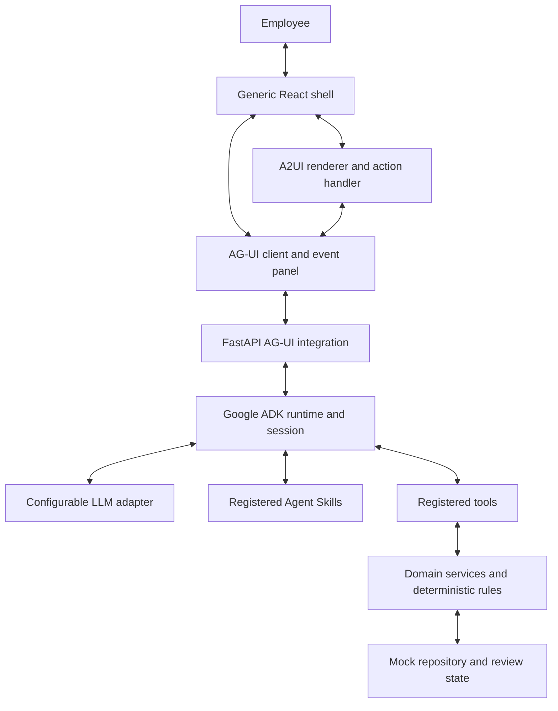
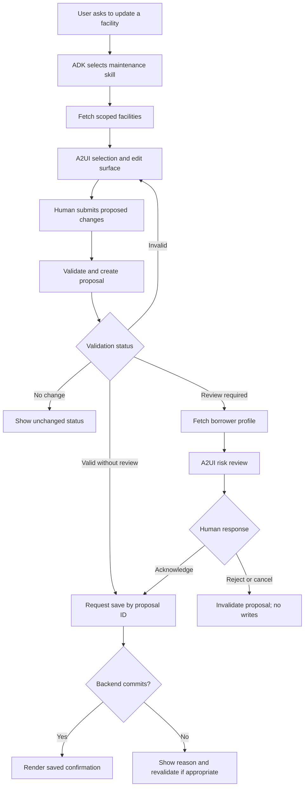

# Agentic Data Maintenance Platform
## Implementation playbook for an AI coding agent — Wholesale Lending POC

**Version:** 1.0 | **Date:** November 18, 2026 | **Status:** Implementation specification; no application has been built or tested by the author of this playbook.

## 1. Assignment to the implementing agent

Build a runnable local proof of concept (POC) demonstrating how a general-purpose agent can maintain business records through dynamically generated user interfaces. Wholesale lending facility maintenance is the first business module, not the identity of the core platform. A future developer should be able to introduce borrower-profile maintenance or another supported business entity by adding tools, skills, metadata, and domain services rather than rewriting the frontend or transport layer.

Implement the requirements and tests below. Keep the demo small, readable, and functional. Do not replace Google ADK, AG-UI, or A2UI with look-alike implementations. Do not connect to a real bank, use real customer information, or assume a model provider. Use synthetic in-memory data. Where this playbook proposes a default rather than a user-mandated decision, document any deviation and why. If a library integration is incompatible, report the exact incompatibility, choose a documented compatible version where possible, and preserve the architecture. Do not claim live model execution if only the simulated mode was exercised.

### Required scope

- Google ADK 2.x (Python) for the agent runtime; Agent Skills for modular workflow knowledge.
- AG-UI for frontend/backend communication and observable execution events.
- A2UI for dynamic facility selection, read-only/editable fields, risk review, and confirmation surfaces.
- Human-in-the-loop interaction for editing and acknowledging a proposed borrower risk change.
- Retrieve facilities, edit the facility amount, validate, conditionally review borrower risk, and save through mock backend tools.
- Model-provider independence: enable implementation and automated testing without credentials, then attach a real model later.
- Generic application shell with no hardcoded facility-specific screens or rules.

### Proposed defaults (not production requirements)

Python 3.13, FastAPI, React + TypeScript, CopilotKit or documented AG-UI client and A2UI renderer integration, pytest, frontend test tooling, and a single-process in-memory repository. Use an accessible desktop-first layout. Exclude real authentication, real databases, regulatory credit models, cloud deployment, MCP, A2A and multi-agent orchestration from the initial scope. Do not introduce those systems merely because they exist. A mock employee identity is sufficient to scope records. A borrower is a lending customer, distinct from the employee using the UI.

## 2. Architecture and decision boundaries



| Concern | LLM / agent responsibility | Deterministic application responsibility |
|---|---|---|
| Intent and workflow | Understand request, select relevant skill, choose next permitted tool | Register tools/skills, scope available operations, manage sessions and lifecycle |
| Data retrieval | Request appropriate records; use returned facts | Resolve actor, verify access, retrieve authoritative records and metadata |
| Rendering | Compose A2UI surfaces using the catalog and field descriptors; explain data | Validate UI messages, render allowlisted components, bind actual values and respect permissions |
| Validation | Interpret tool results, explain errors, request corrections | Enforce editability, types, bounds, required fields, record version and business rules |
| Risk review | Recognize review requirement; fetch associated borrower and explain the proposed impact | Compute current/proposed risk, determine whether acknowledgment is mandatory |
| User acknowledgment | Present the review and route response | Accept acknowledgment only from a correlated user interaction; bind it to a specific pending proposal |
| Save | Request save after successful validation and any required review | Revalidate, verify acknowledgment, enforce concurrency and idempotency, commit atomically |
| Progress | May provide plain-language summaries | Emit actual execution/tool/interrupt events and authoritative operation outcomes |

The central rule is **the agent orchestrates; deterministic code enforces**. Skills are procedural instructions, not the authoritative policy engine. Neither the LLM nor the browser can grant access, manufacture approval, bypass review, choose authoritative risk classifications, or directly mutate repositories. A successful tool invocation must be confirmed before announcing a save. Do not expose hidden reasoning or internal prompts in the UI activity panel.

## 3. Integrations and model configuration

### 3.1 Libraries and compatibility checkpoint

Start with ADK 2.x. As of the playbook date, PyPI lists `google-adk` 2.14.1 (November 12, 2026); treat that as a candidate, not a validated combination with the other libraries. Consult the ADK AG-UI and CopilotKit guides, and try the documented ADK/AG-UI bridge (`ag-ui-adk`) and FastAPI setup. Choose one A2UI version and its matching catalog/renderer based on the actual integration; do not mix version-specific message schemas. The coding agent must run a minimal real-protocol smoke test: stream a run, render a surface, submit an action, resume the same logical workflow. Record and lock compatible dependency versions and the exact startup commands in the repository README.

AG-UI is an event protocol, commonly streamed over HTTP/SSE; A2UI is a declarative UI protocol transported through a supported integration. Use the integration's actual A2UI message envelope and event types. Never invent standard event names or send the application metadata below directly to an A2UI renderer as if it were the official protocol.

For HITL, select one documented ADK bridge flow supported by the pinned client: resumable interrupts (when supported) or frontend/long-running tool-result continuation. Do not mix the two. If a run ends at an interrupt, resume the same logical thread with its correlated response, not a new independent workflow. The SSE connection does not have to stay open while a person reviews a form.

### 3.2 LLM configuration (open decision)

Keep provider, model identifier, endpoint and credential mechanism external to domain code; expose an ADK-compatible model factory. Provide `.env.example` with non-secret settings such as `AGENT_MODE=mock|live` and placeholders for live provider/model settings. Choose the actual provider with the project owner later. Never require credentials to launch mock mode.

- **Mock mode:** use a scripted ADK-compatible model/test double to return deterministic decisions and tool requests. Reuse the same domain tools, app action handling, and genuine AG-UI/A2UI transport and renderer. Clearly label scripted behavior in the UI. Fixture UI responses are permitted in this mode, and should exercise the real declared A2UI format.
- **Live mode:** connect the eventual supported model through ADK with the same tools, skills and catalog. The model must support the necessary tool calling and structured UI generation. If configuration is missing, fail with a clear setup message, not a silent fake live run.

A working mock demo proves the integration and rule enforcement, not that an LLM reliably performs the task. Validate live behavior separately after the model is selected. Prefer one agent; use additional agents or an ADK graph only if justified by the POC. Hardcoded domain-specific orchestration in mock test fixtures must never become the live core workflow.

## 4. User experience

```
+-----------------------------------------------------------------+
| Agentic data maintenance                         MOCK / LIVE    |
+-----------------------+-----------------------------------------+
| AG-UI activity        | A2UI workspace                           |
|                       |                                         |
| Run started           | Facility: FAC-1001 — Atlantic Industries|
| Skill selected        | Borrower: Atlantic Industries LLC        |
| Facilities retrieved  | Currency: USD  (read only)              |
| Form rendered         | Outstanding: $250,000 (read only)        |
| Awaiting user input   | Facility amount: [ 1250000          ]    |
|                       |                                         |
|                       | [Cancel]              [Review / Save]   |
+-----------------------+-----------------------------------------+
| Request: [ Update a facility ...                         ] [Go] |
+-----------------------------------------------------------------+
```

Left panel: chronological actual AG-UI lifecycle, tool start/result status, user input/approval pending, success or error. Use human-friendly labels and optionally event IDs/timestamps; do not dump unfiltered sensitive payloads. Loading indicator while the agent runs, distinct waiting status while the human must act. Collapse or scroll long histories without losing state. Right/main panel: generic A2UI renderer supporting text, layouts, labeled inputs, selections, buttons, checkboxes or equivalent components in the chosen catalog. Provide a simple text entry or generic launcher to initiate a workflow. No facility-specific React components. Do not create HTML, arbitrary JavaScript, or executable URLs from model output.

**Screens:** start, facility selection, details/edit form, validation errors, conditional borrower review, saved confirmation, cancel/error. All business surfaces use A2UI. Bind current values to the A2UI data model; read-only fields use display text or a supported disabled control. Validate the surface against the catalog and field policy; reject or regenerate invalid surfaces. Reuse the same action handler regardless of entity type. Enable submit only when appropriate; server-side checks remain mandatory. Render inline errors and preserve valid draft input on recoverable failures. Do not present a proposed risk change as already committed.

## 5. Synthetic lending data

Use USD-only facilities for the initial POC; serialize money as canonical decimal strings and parse with Python `Decimal`, never binary floating point. Display USD formatting in the UI. Amount means committed facility limit, not balance. Dates use ISO 8601 (`YYYY-MM-DD`).

| Facility ID | Borrower | Facility type | Amount | Outstanding | Spread | Maturity | Status | Version |
|---|---|---|---:|---:|---:|---|---|---:|
| FAC-1001 | BOR-2001 | Revolving credit | 750000.00 | 250000.00 | 250 bps | 2029-12-31 | Active | 1 |
| FAC-1002 | BOR-2002 | Term loan | 1250000.00 | 400000.00 | 300 bps | 2030-06-30 | Active | 1 |
| FAC-1003 | BOR-2001 | Revolving credit | 300000.00 | 50000.00 | 200 bps | 2028-12-31 | Active | 1 |
| FAC-1004 | BOR-2003 | Term loan | 600000.00 | 100000.00 | 275 bps | 2029-06-30 | Active | 1 |

| Borrower ID | Name | Industry | Risk | Version | Scope |
|---|---|---|---|---:|---|
| BOR-2001 | Atlantic Industries LLC | Manufacturing | STANDARD | 1 | Demo employee |
| BOR-2002 | Summit Logistics Inc. | Transportation | ELEVATED | 1 | Demo employee |
| BOR-2003 | Harbor Services Ltd. | Business services | STANDARD | 1 | Other employee only |

Mock actor `EMP-001` may access BOR-2001 and BOR-2002 and their facilities; actor `EMP-002` may access BOR-2003. Resolve actor from trusted session context, never from model-supplied identity. This is simulated authorization, not production authentication. Record lookup by guessed ID must still enforce access. Initialize risk from the rule, not an inconsistent fixture. Reset demo data through an explicitly marked development/test mechanism, not an agent business tool.

### Field policy

| Field | Type | Access | Constraints |
|---|---|---|---|
| facilityId | string | Read-only | Stable identifier |
| borrowerId / borrowerName | string | Read-only | Existing associated borrower |
| facilityType | enum | Read-only | Revolving credit or term loan |
| currency | string | Read-only | USD |
| facilityAmount | money | Editable, required | Positive; at least outstanding; maximum $100M for demo |
| outstandingBalance | money | Read-only | Nonnegative |
| interestSpreadBps | integer | Editable (secondary) | 0–2000 bps inclusive |
| maturityDate | date | Editable (secondary) | Valid date; no earlier than configured demo business date |
| status | enum | Read-only | Active for seed records |
| borrowerRiskClassification | enum | Read-only / derived | STANDARD or ELEVATED |
| version | integer | Server-managed | Optimistic concurrency |

Facility amount is mandatory for the demo; the other two writable fields are proposed defaults that show generic type handling. The business date can be injected for reproducible tests. Reject unknown/read-only fields, nulls on required fields, nonfinite values, malformed numbers, precision beyond cents, invalid dates, and amounts below the outstanding balance. Do not silently discard invalid fields or use display text for calculations.

### POC risk rule (fictional)

The threshold is **USD 1,000,000.00 inclusive**. A borrower's risk is ELEVATED if any of its active facilities has an amount greater than or equal to that threshold; otherwise STANDARD. This is a simplified fictional classification, not a real credit score, rating methodology, or lending approval. Centralize it in configuration/domain code. Calculate current and proposed borrower risk using authoritative data, substituting the proposed facility amount in the hypothetical calculation. If the borrower classification would actually change, require explicit acknowledgment in either direction. If another facility already keeps the borrower elevated, no risk-change acknowledgment is required merely because the edited facility crosses the threshold. Show an explanation if appropriate. No change is saved before any required acknowledgment.

## 6. Generic contracts (application-level, not AG-UI/A2UI schema)

Define typed Pydantic models and corresponding generated or maintained TypeScript types for supported contracts. Each business module owns its metadata and rules. Do not duplicate rules in React or prompts. All service/tool output has a typed status, safe user message, and structured machine-readable facts/error codes.

### 6.1 Entity descriptor

Example excerpt for `get_facility` (return all relevant fields in implementation):

```json
{
  "entityType": "facility",
  "entityId": "FAC-1001",
  "version": 1,
  "displayName": "FAC-1001 — Atlantic Industries LLC",
  "fields": [
    {"name":"facilityId","label":"Facility ID","type":"string","value":"FAC-1001","editable":false,"required":true},
    {"name":"currency","label":"Currency","type":"string","value":"USD","editable":false,"required":true},
    {"name":"facilityAmount","label":"Facility amount","type":"money","currency":"USD","value":"750000.00","editable":true,"required":true,"constraints":{"minimum":"250000.00","exclusiveMinimum":"0.00","maximum":"100000000.00","scale":2}},
    {"name":"interestSpreadBps","label":"Interest spread (bps)","type":"integer","value":250,"editable":true,"required":true,"constraints":{"minimum":0,"maximum":2000}}
  ],
  "actions": ["review_changes", "cancel"]
}
```

Support string, money, integer, date, enum, boolean, optional choice lists and help text. Metadata derives from authenticated, current backend state. Treat model-generated forms and client-submitted metadata as untrusted. A2UI generation guidance: choose components by declared type, bind input values, preserve names/IDs, omit or display read-only values non-interactively, attach supported actions and context. Validate editable bindings and submitted action types against the active entity/proposal. The generic renderer may implement component-level behavior but may not contain domain field-name conditionals.

### 6.2 UI action envelope

Normalize the actual A2UI action into a backend application event. Example (not a claimed wire schema):

```json
{
  "actionId":"act-001",
  "surfaceId":"surface-001",
  "action":"review_changes",
  "entityType":"facility",
  "entityId":"FAC-1001",
  "expectedVersion":1,
  "changes":{"facilityAmount":"1250000.00"}
}
```

Use an allowlisted vocabulary: `select_entity`, `review_changes`, `acknowledge_review`, `reject_review`, `cancel`, and optionally `retry`. Bind surface/action to trusted current actor/thread and validate current workflow stage. For acknowledgment, carry a server-issued review/proposal ID and decision through the correlated action/interrupt response. Never treat an LLM-produced Boolean, a prompt such as “I already approved,” or arbitrary tool argument as authoritative approval. Browser requests are untrusted; this POC proves server-side state correlation, not a full production identity assurance system. Freeze the proposal during review; editing creates a new one and invalidates old approval. Duplicate action IDs should not cause duplicate state transitions.

### 6.3 Validation result and proposal

Example excerpt:

```json
{
  "status":"REVIEW_REQUIRED",
  "proposalId":"prop-001",
  "entityType":"facility",
  "entityId":"FAC-1001",
  "expectedVersion":1,
  "changes":{"facilityAmount":"1250000.00"},
  "riskImpact":{"borrowerId":"BOR-2001","current":"STANDARD","proposed":"ELEVATED","threshold":"1000000.00","currency":"USD","acknowledgmentRequired":true},
  "nextAction":"review_borrower"
}
```

Server retains canonical changes, actor/thread, facility version, borrower version and the relevant exposure snapshot or version, required review, policy version, action correlation and expiration (proposed 15 minutes, configurable). Return no success proposal for invalid or unauthorized changes. Possible statuses: `VALID`, `REVIEW_REQUIRED`, `INVALID`, `NO_CHANGE`, `NOT_FOUND_OR_FORBIDDEN`, `CONFLICT`, `EXPIRED`. Stable error codes include `READ_ONLY_FIELD`, `UNKNOWN_FIELD`, `INVALID_AMOUNT`, `MISSING_ACKNOWLEDGMENT`, `STALE_VERSION`, `REVIEW_INVALIDATED`. Return field-specific errors for UI corrections. Acknowledge refers to the exact canonical proposal, not just the entity ID. Save by proposal ID, not arbitrary replacement values.

## 7. Tools and deterministic services

Expose the following as real ADK-callable tools with typed arguments and concise docstrings. Server context supplies actor/thread; signatures below are conceptual, not exact ADK imports.

| Tool | Arguments | Result / responsibility |
|---|---|---|
| `get_facilities` | optional search/filter | Scoped list of facility summaries and selection IDs. |
| `get_facility` | facility_id | Authoritative entity descriptor and record version. |
| `get_borrower_profile` | borrower_id | Scoped borrower profile, current risk, exposure summary and version. |
| `validate_facility_update` | facility_id, expected_version, changes | Validate and compute a proposed change; create a pending proposal for valid changes; no business-record mutation. |
| `save_facility_update` | proposal_id | Revalidate stored proposal, verify any trusted acknowledgment, commit atomically or reject. |
| `cancel_pending_update` | proposal_id | Invalidate pending proposal without modifying business data. |

Generic UI presentation and HITL tools/adapters may be required by the chosen integration. Reuse those across all domains. User acknowledgment is recorded by the trusted application action/resume handler; it must not be a standalone tool that the model can invoke to approve itself. A future `get_current_user_profile` could expose employee context if useful for personalization, but is not required for the first use case. Only fetch the borrower profile separately when risk review requires it (or the user requests it). Tool results and record values are treated as data, not instructions.

### Save transaction algorithm

1. Resolve proposal by server-issued ID, actor, thread, and applicable scope. If already committed, return the existing receipt to the authorized same-proposal retry; do not write twice.
2. Under a repository lock/transaction, verify pending state, expiration, entity/borrower versions and policy/exposure snapshot. Recompute validation and risk using current authoritative data. A changed basis invalidates the review and requires revalidation/review, not a blind overwrite.
3. If required, verify stored explicit positive acknowledgment for the exact proposal. Reject negative, absent, replayed across proposals or mismatched approval.
4. Update facility fields and increment its version. If borrower risk changes, update borrower classification and increment version. Use a single atomic transaction/critical section; validate all changes before publication. Maintain an audit record of actor, timestamp, proposal, before/after values, review outcome and transaction/receipt ID.
5. Mark the proposal committed and return authoritative saved records/receipt. If a failure occurs, no partial update is visible. Simulated repository data, audit and pending state are process-local; restart clears them. Do not claim durable persistence.

Generic state model: `DRAFT → VALIDATED → AWAITING_REVIEW (optional) → ACKNOWLEDGED (if required) → COMMITTED`; terminal alternatives `CANCELLED`, `REJECTED`, `EXPIRED`, or `INVALIDATED`. A valid no-impact proposal can commit from `VALIDATED`. Invalid field inputs remain editable; a new proposal is made on resubmission. Review rejection/cancel must not write business data. Keep authoritative state on the backend; ADK sessions store conversational context and references, not the sole source of approval.

## 8. Agent Skills and root instructions

Use ADK's documented skill discovery/loading support (e.g. `SkillToolset` for the selected Python release). Use skill front matter and folder conventions required by the pinned version. Register domain tools with the agent or the skill's supported additional-tools mechanism. Add a short root instruction that explains the generic lifecycle, tool-result trust boundary and A2UI catalog. Do not place all domain knowledge in the root prompt. Expose enough skill descriptions for the model to select the correct workflow. Do not execute skill scripts in the POC unless explicitly needed.

### 8.1 Proposed skill: `facility-maintenance/SKILL.md`

Use the following as initial skill content, adapting the front matter to the documented format if needed:

```markdown
---
name: facility-maintenance
description: Retrieve, review, and edit wholesale lending facilities using interactive forms and validated updates.
---

# Facility maintenance

1. For a facility maintenance request, call get_facilities to retrieve the actor's accessible facilities. If a facility is already unambiguously selected, retrieve it directly with get_facility. Never infer access from an identifier.
2. If a selection is needed, present an A2UI list or selector with authoritative identifiers, borrower names and facility summaries. Wait for the correlated user action.
3. Call get_facility and create an A2UI edit surface using the returned field metadata. Preserve read-only values, exact field names, record version and the supported actions. Do not invent fields or values.
4. Wait for the user to submit proposed changes. Call validate_facility_update with those exact changes and the expected version. Do not calculate the authoritative credit risk yourself.
5. If INVALID, explain the tool's field errors and allow correction. If NO_CHANGE, present that outcome. If a conflict occurs, refresh and require a new proposal.
6. If REVIEW_REQUIRED, follow the credit-risk-review skill. Do not call save before the required review has been accepted by the trusted action handler. If VALID and no review is required, proceed to save as requested by the user's submission.
7. Call save_facility_update with the validated proposal ID. Report success only if the tool confirms COMMITTED; otherwise explain the returned status and allowed next step.
8. On cancellation, invalidate any active proposal and report that no pending update was saved. Do not modify other entities outside this workflow.
```

### 8.2 Proposed skill: `credit-risk-review/SKILL.md`

```markdown
---
name: credit-risk-review
description: Explain and obtain human acknowledgment for an authoritative proposed borrower credit risk classification change during record maintenance.
---

# Credit risk review

1. Trigger when a validation tool returns REVIEW_REQUIRED. Use the borrower ID and current/proposed risk values from that result. Call get_borrower_profile to retrieve the current profile and relevant authorized context. If the profile no longer matches the validation basis, request revalidation.
2. Render an A2UI review surface identifying the borrower, facility, original and proposed facility amount, current and proposed risk classifications, and explanation supplied by the validation service. Make clear the change is proposed, not saved. Display the fictional POC policy context.
3. Present explicit Acknowledge and save / Reject or cancel actions tied to the server-issued proposal. Wait for the human's correlated response. Do not infer approval, approve for the user, or reclassify risk yourself.
4. On confirmed positive acknowledgment, return to the originating maintenance workflow so it can request save. On rejection or cancellation, invalidate the proposal without changing records; allow the user to start a new edit if desired.
5. Explain results faithfully. If the backend rejects a save, never claim the risk or facility has been updated.
```

The agent may retrieve the second skill on demand; domain-independent orchestration should not have hardcoded facility/risk branches. Domain-specific tool results, instructions and capabilities guide the agent. Backend rules enforce review even if the model fails to load the appropriate skill.

## 9. End-to-end workflow and example



1. Employee enters “Update a facility.” Agent loads facility skill, fetches scoped list, and presents selectable facilities. Restrict list to permitted borrower relationships.
2. Employee selects FAC-1001. Agent calls get_facility and generates an A2UI form. Current facility amount $750,000; outstanding $250,000; borrower risk STANDARD.
3. Employee enters $1,250,000 and submits Review / Save. The user action reaches the same workflow through the chosen AG-UI integration. The validation tool returns REVIEW_REQUIRED with proposal ID and STANDARD → ELEVATED. Business records are still unchanged.
4. Agent loads review skill, calls get_borrower_profile and renders a review surface: “The proposed facility limit is increasing from $750,000 to $1,250,000 and would change Atlantic Industries LLC's simulated credit risk classification from Standard to Elevated. Review and acknowledge this proposed change before saving.” Show current and proposed information side by side.
5. Employee acknowledges and saves. The backend action handler records acknowledgment for this exact proposal; agent resumes and calls save. Atomic mock transaction updates both facility and borrower, returns receipt, and displays a confirmation. A second retrieval reflects the new amount and risk.
6. Repeat with FAC-1002, reducing $1,250,000 to $750,000, to demonstrate the reverse ELEVATED → STANDARD review. A within-band change requires no additional risk review. Rejection, cancel, or invalid inputs must not change either record.

### Illustrative event timeline (semantic labels, not invented wire event types)

| User-visible stage | Source |
|---|---|
| Run started | AG-UI run lifecycle event |
| Facility retrieval started / completed | Actual tool events |
| Facility selection displayed / waiting | A2UI surface and correlated UI wait |
| Facility details retrieved / form displayed | Actual tool events and A2UI messages |
| Change validated | Validation tool result |
| Borrower profile retrieved | Actual tool result |
| Awaiting acknowledgment | Supported HITL pause/action mechanism |
| User acknowledged | Accepted correlated response |
| Saving / saved | Real save tool invocation/result |
| Run finished | Actual AG-UI lifecycle event |

A logical workflow can span multiple runs. Map actual event types from the installed SDK into the display, including errors and interrupted outcomes. Do not imply a completed run necessarily means the overall transaction completed. Retain `thread_id`, `run_id`, `surface_id`, `action_id`, and proposal correlation as appropriate. Ignore stale/duplicate UI actions; disable repeated submits while processing. On disconnect, preserve backend proposals until expiration; surface retry or restart rather than falsely assuming the operation failed/succeeded. Idempotent receipt lookup handles ambiguous save responses.

## 10. Extensibility and maintainability

Separate a generic platform package from business modules. Each module contributes skill folders, registered tools, entity descriptors, authorization and validation/persistence implementations through a registry. Prefer explicit registration at startup for the POC; adding a registration is acceptable, rewriting core logic is not. Do not introduce dynamic arbitrary-code loading or a plugin framework that is unnecessary for a small application. Shared generic workflow infrastructure handles correlation, proposal lifecycle, A2UI validation and state, event rendering and trusted user action handling. A module defines its own business rules and data operations. Domain tools may differ across modules; their result envelope and UI action model should remain consistent.

Illustrative layout (adjust to installed framework conventions):

```text
project/
  README.md
  .env.example
  backend/
    pyproject.toml
    app/
      main.py                 # FastAPI and genuine AG-UI endpoint
      agent.py                # ADK agent, model factory, registered modules
      skills/                 # discoverable SKILL.md directories
        facility-maintenance/SKILL.md
        credit-risk-review/SKILL.md
      platform/
        contracts.py          # generic descriptors, results, UI action models
        registry.py           # module registrations
        sessions.py           # actor/thread context; per-thread state
        actions.py            # trusted action validation/resume
        proposals.py          # generic lifecycle/acknowledgment mechanisms
        ui_adapter.py         # A2UI catalog/message validation and delivery
        model_factory.py      # mock/live ADK model configuration
      modules/
        lending/
          models.py
          metadata.py
          repository.py       # synthetic repository/seed and atomic commit
          policy.py           # edit permissions and risk threshold
          service.py          # validation and save operations
          tools.py            # ADK function wrappers
      tests/
        unit/
        integration/
  frontend/
    package.json
    src/
      App.tsx                 # reusable shell
      agui/                   # SDK client and actual event mapping
      a2ui/                   # renderer, catalog, generic action bridge
      components/             # activity panel and reusable UI chrome
    tests/
```

Skills may be packaged with their domain modules and discovered via ADK's supported locations. The starter paths above are conceptual, not mandatory SDK API assumptions. Keep the root agent's instructions independent of lending vocabulary except for dynamically offered registered skills/tools.

**Extension demonstration (small optional implementation, mandatory extensibility test):** register a synthetic borrower-profile maintenance skill and tools that allow editing a business contact email while borrower ID and derived risk remain read-only. Use the same shell and descriptor/action contracts. Add no borrower-specific React component or new core transport code. A minimal test module is enough to demonstrate the extension point; a full second production use case is out of scope. Some future UI types may legitimately require extending the shared component catalog, but not a domain-specific frontend screen for each entity.

## 11. Implementation sequence and deliverables

1. **Integration spike:** verify and lock compatible Python and Node packages. Bootstrap ADK/FastAPI AG-UI endpoint, React AG-UI client, real A2UI renderer, and one mock-model round trip with correlated user input. Document protocol versions and selected HITL path.
2. **Domain layer:** implement seed repository, actor scope, field descriptors, Decimal validation, borrower risk rule and atomic commit. Unit-test without agent or frontend.
3. **Generic application layer:** implement typed envelopes, proposal and acknowledgment lifecycle, version checking, validated actions, session correlation, UI validation, idempotency and receipts.
4. **Agent layer:** register tools, skills and mock/live model factory. Use mock behavior to exercise standard and review flows. Ensure live configuration remains isolated and unconfigured by default.
5. **User interface:** real AG-UI activity panel, generic A2UI workspace, initiation input, loading/waiting/error states and user actions. No business-specific forms in React.
6. **Verification:** run unit, integration and browser tests; demonstrate both risk transition directions, no-review flow, rejection and attempted bypass. Add a lightweight extension test. Document actual test results and unresolved integration/model limitations.

Deliver source code, lockfiles, sample env file, synthetic seed/reset procedure, all tests, and README with exact install/run/test steps, protocol/version choices, architecture overview, screenshots or short demo steps if feasible, limitations, and instructions for registering a new skill and tool module. No paid or external services should be necessary in mock mode. Include explicit steps to attach a model later and a separate live-model acceptance checklist. An optional local Docker Compose configuration is acceptable if useful, but not required. Do not report implementation complete unless the mandatory tests pass, or list failures explicitly.

## 12. Acceptance tests

Run each scenario against an isolated seed/reset or set explicit preconditions. Assert authoritative repository contents, action state, and relevant actual event/UI behavior, not just the model's prose.

| ID | Scenario | Expected outcome |
|---|---|---|
| A01 | Launch mock mode with no LLM credentials | App works and clearly identifies scripted mode |
| A02 | Request update as EMP-001 | Only FAC-1001/1002/1003 available; FAC-1004 inaccessible |
| A03 | Select FAC-1001 | Actual A2UI renders authoritative details; amount editable; ID/currency/balance read-only |
| A04 | $750k → $900k | Valid; no extra risk review; saves amount; borrower remains STANDARD |
| A05 | $750k → $1.25M | Before acknowledgment: pending review, original records unchanged, profile shown |
| A06 | Acknowledge A05 | Both amount and borrower risk update atomically; receipt and actual event confirmation |
| A07 | Reject/cancel A05 | Both records unchanged; proposal unusable |
| A08 | FAC-1002 $1.25M → $750k | ELEVATED → STANDARD only after acknowledgment |
| A09 | FAC-1001 $750k → exactly $1M | Inclusive threshold; acknowledgment required |
| A10 | FAC-1002 $1.25M → $1.5M | Remains ELEVATED; no extra review |
| A11 | FAC-1001 already elevated, then FAC-1003 crosses $1M | Borrower remains ELEVATED; no classification-change review |
| A12 | Amount negative, below outstanding, nonnumeric, too precise, over cap, or nonfinite | Validation rejects; no writes; correction allowed |
| A13 | Submit ID/currency/derived risk or unknown field | Reject, including mixed valid and invalid fields; no writes |
| A14 | Agent calls save before required review | Save rejects; no business-record writes |
| A15 | Model invents acknowledgment / old review replayed for new amount or other actor/thread | Rejected; no writes |
| A16 | Another edit changes record, exposure basis or policy after review | Stale proposal rejected; require fresh validation and review if needed |
| A17 | Duplicate submit/save or retry after lost response | Same committed receipt returned when authorized; exactly one business transition |
| A18 | Simulated exception during commit | No partial facility/borrower change; appropriate error displayed |
| A19 | Cancel, expiry or disconnect with pending proposal | No automatic commit; expired/cancelled proposals cannot save |
| A20 | Invalid UI catalog component or forged writable binding | Surface rejected or regenerated; backend independently rejects forbidden updates |
| A21 | AG-UI runs, tool events, action pause and resume | Real protocol events map to activity panel; genuine A2UI renders and submits across the same workflow |
| A22 | Register a second test entity and skill | Same frontend/transport works with new metadata/actions; no core domain conditionals |
| A23 | Invalid spread/date or no-op change | Appropriate rejection or NO_CHANGE; no unintended writes |
| A24 | Missing live model settings | Clear configuration error; no silent simulated fallback |

**Live-model checklist (deferred until connection information is supplied):** verify model selects appropriate skills and tools, generates valid A2UI dynamically from metadata, handles previously unseen valid field descriptions, requests actual human review when required, uses authoritative tool results, and recovers from model mistakes without violating rules. Run repeated evaluations, including prompt injections requesting read-only edits or forged approvals. Record failure rates and examples. Passing mock tests alone does not establish live-model reliability.

## 13. Decisions, assumptions, and limitations to carry forward

- Confirmed scope: generic agentic data maintenance, wholesale lending facility POC, Google ADK 2, AG-UI, A2UI, tools and skills, left event panel, main dynamic surface, human editing and risk acknowledgment, fake backend, model connection deferred.
- Proposed design choices needing no further input for the POC: Python/FastAPI, React/TypeScript, in-memory single-process data, mock actor scope, $1M inclusive threshold, borrower-level classification across active facilities, two additional editable fields, and a configurable 15-minute review expiration. All records and risk policy are fictional.
- Model connection and credentials are deliberately unresolved. The exact compatible ADK/AG-UI/A2UI release combination and protocol mechanics must be confirmed by the coding agent's integration spike. No application has been implemented or dependency compatibility executed in this playbook preparation.
- Future production requirements (out of scope): institutional identity/authorization, persistent transactional database, durable HITL state, enterprise credit/risk controls and approval policy, independent audit/compliance review, privacy, observability, security testing and deployment. The mock acknowledgment is not an actual credit approval.

## 14. Implementation reference links

Documentation verified during preparation, November 18, 2026. Prefer official documentation and matching tagged package releases over examples on moving main branches. Pin versions after the smoke test.

- ADK Python package/release information: https://pypi.org/project/google-adk/
- ADK skills: https://adk.dev/skills/
- ADK AG-UI integration: https://github.com/google/adk-docs/blob/main/docs/integrations/ag-ui.md
- ADK CopilotKit integration: https://adk.dev/integrations/copilotkit/
- Google guide to ADK, A2UI and CopilotKit: https://developers.googleblog.com/build-generative-ui-apps-with-a2ui-copilotkit-agents/
- AG-UI official protocol introduction: https://github.com/ag-ui-protocol/ag-ui/blob/main/docs/introduction.mdx
- ADK AG-UI bridge HITL/tool behavior: https://github.com/ag-ui-protocol/ag-ui/blob/main/integrations/adk-middleware/python/TOOLS.md
- CopilotKit ADK integration: https://docs.copilotkit.ai/google-adk
- A2UI component catalogs: https://a2ui.org/concepts/components/
- A2UI v1 protocol reference (use only if selected version matches): https://github.com/a2ui-project/a2ui/blob/main/specification/v1_0/docs/a2ui_protocol.md

**Final instruction to the coding agent:** Build the smallest real end-to-end implementation satisfying these requirements. Prefer correct, observable execution and reusable boundaries over speculative abstractions. Demonstrate the facility amount update and mandatory risk review first. Keep live model configuration replaceable, and show precisely what has and has not been proven.
